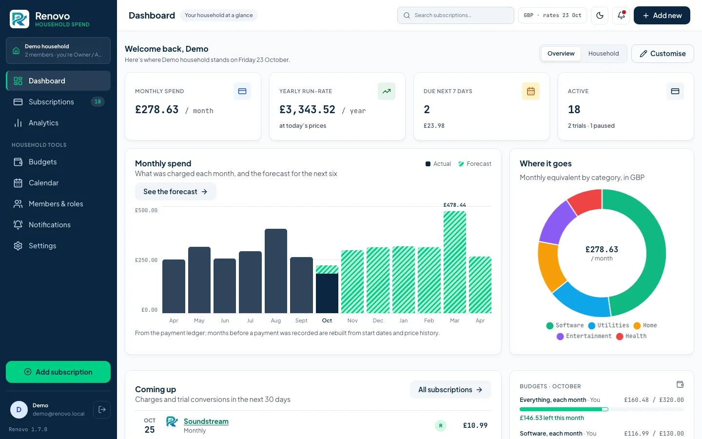
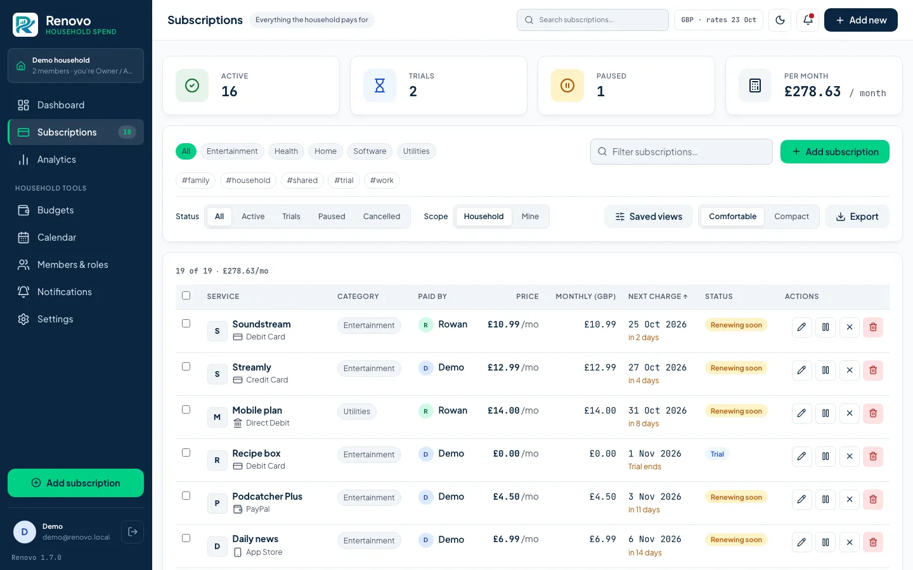
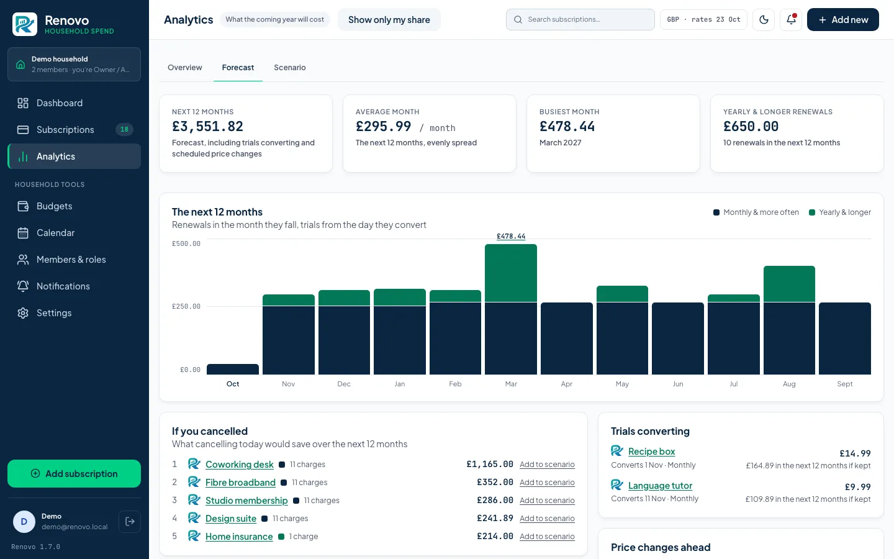
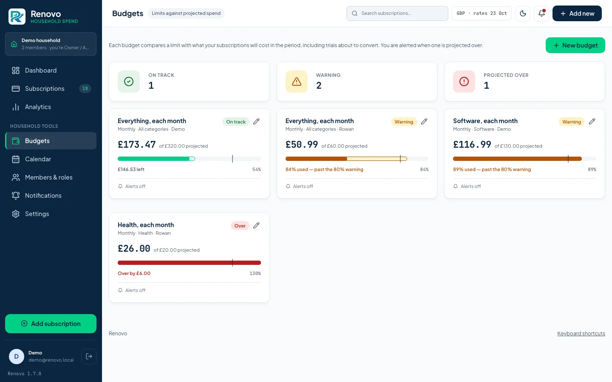
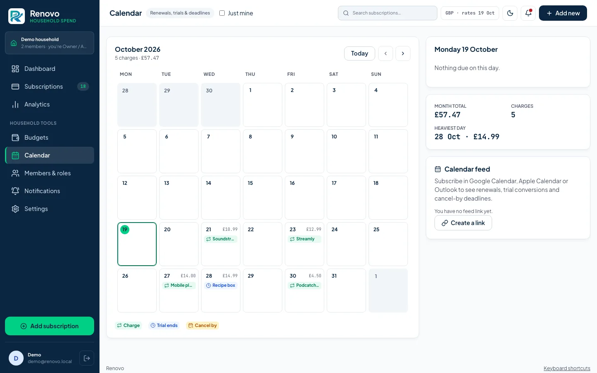
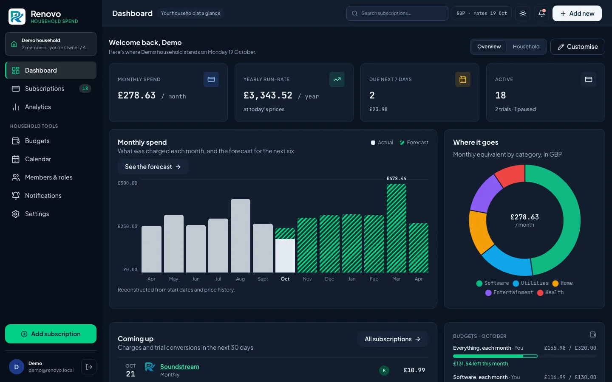
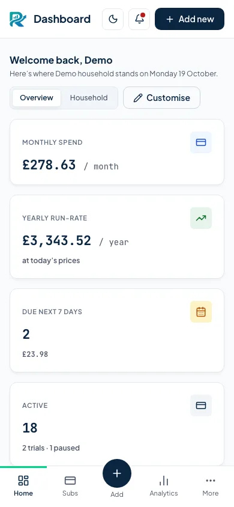

# Renovo

Renovo tracks your **subscriptions and recurring bills**: what each one costs,
what the year adds up to, and what is about to renew. It is **self-hosted**, so
it runs on your own server, and it is built for a household: several people,
each with a role, sharing one view of what goes out every month.

## Who it is for

**For** a household, or a single person, who wants to see every recurring
charge, what it will cost this year, and what is about to renew. You want it
on your own server, on a LAN or behind a VPN, and you want it to load nothing
from anywhere else. Every byte the browser fetches comes from your instance.

**Not for** anyone who wants bank or transaction sync. Renovo knows what you
tell it, and reading a bank feed is ruled out (see
[ROADMAP.md, *Not planned*](ROADMAP.md#not-planned)). Nor is it for anyone
looking for a hosted service. There isn't one.

## What it looks like


*The Overview dashboard: what goes out each month, what is due next, and where it goes.*


*My subscriptions: every recurring charge, filterable, with its next date and monthly cost.*


*The forecast: the next twelve months, including trials converting and scheduled price changes.*


*Budgets: each one is checked against projected spend, before the money goes out.*


*The calendar: renewals, trial conversions and cancellation deadlines by day.*


*The same dashboard in the dark theme.*



*On a phone: the same dashboard, with the navigation along the bottom.*

## Quick start

**Run it.** Clone the repository, write `.env` with a session key, and start
the stack:

```bash
git clone https://github.com/gwpreston16/Renovo.git && cd Renovo
cp .env.example .env
printf 'SESSION_KEY=%s\n' "$(openssl rand -hex 32)" >> .env
docker compose up
```

Then open **http://localhost:9090** and complete the first-run wizard. The
account you create there is the instance administrator.
[docs/install.md](docs/install.md) covers MySQL/MariaDB, running without
Docker, and the development stack.

**Try it with sample data.** One command starts the development stack and
fills it with a household of two people:

```bash
./bin/dev-setup.sh --with-sample-data
```

It checks your prerequisites, starts everything, and prints the sign-in details
for both accounts (an Owner/Admin and a Contributor) when it is ready.

## What it does

**Tracking** ([docs](docs/features/tracking.md))

- Subscriptions and recurring bills, on any cycle: weekly, monthly, yearly or
  every N weeks, months or years.
- Free trials that convert on their date, and introductory prices that end.
- Contract end dates, fixed terms that stop after their last payment, and
  bills whose amount varies.
- Notice periods, and a "cancel by" date worked out from them.
- Categories, tags and payment methods, with saved list views.
- Import from CSV or JSON, with every row previewed before it is written.

**Money** ([docs](docs/features/money.md))

- Totals in any currency, converted at cached exchange rates.
- Price history, with price changes scheduled ahead.
- Budgets checked against projected spend, a twelve-month forecast, and a
  scenario planner for "what if I cancelled these?".
- Analytics, year over year, and shared costs split between members.
- A payment ledger: record what was charged, skip a charge, attach an invoice
  to a payment, and page the calendar back through past months.
- What introductory offers, discounts and cancellations have saved you,
  counted from what was actually charged.

**Notifications** ([docs](docs/features/notifications.md))

- Reminders before a renewal, a trial conversion or a cancellation deadline,
  and alerts for budgets, price changes and contracts ending.
- Email, Gotify, Slack, Discord, Telegram, Pushover, ntfy, Mattermost and more,
  or a signed generic webhook.
- Per-person lead times and digests, and each alert routed to the channels you
  choose.

**Households and people** ([docs](docs/features/households.md))

- Roles per household: Owner/Admin, Editor, Contributor and Viewer.
- SHARED or ISOLATED data, applied centrally on every read and write.
- Members join by invitation.

**Sign-in and security** ([docs](docs/security.md))

- Two-factor sign-in with an authenticator app, and passkeys and security keys.
- Active sessions you can revoke, and an audit log.
- Every outbound request goes through one guarded client, which refuses
  private addresses unless an administrator allows them. It can also be turned
  off, or limited to a list of hosts, and each refusal is audited
  ([outbound requests](docs/operations.md#outbound-requests)).
- Dependencies and Docker images are scanned in CI. To report a vulnerability,
  see [SECURITY.md](SECURITY.md).

**Your data** ([docs](docs/operations.md))

- Import and export, and whole-household backup and restore, files included.
- Scheduled instance backups of everything: encrypted, checked after they are
  written, pruned by policy, and restorable into PostgreSQL or MySQL. Each
  verified backup can be sent off the server (S3-compatible storage, WebDAV or
  a directory) with its own retention, and a scheduled rehearsal restores from
  a destination and alerts instance administrators when it fails. Keep the key
  somewhere that is not the server.
- An iCalendar feed of what is due ([calendar](docs/features/calendar.md)).
- Invoices and receipts attached to a subscription.
- A versioned JSON API with an OpenAPI contract ([API](docs/api.md)).

**Making it yours** ([docs](docs/features/customising.md))

- Light, dark or system theme, and a choice of palettes.
- Comfortable or compact lists, a dashboard you can rearrange, and keyboard
  shortcuts.
- Each person chooses their language, and dates and money are formatted to
  match it.

## Requirements

- **Docker** and the Compose plugin (the supported way to run it), or
- **PHP 8.4+** with `pdo_pgsql` or `pdo_mysql`, `intl`, `curl`, `zip`, `gd`,
  `openssl` and `sodium` (the last two are bundled with most builds; they
  encrypt stored two-factor secrets and verify passkeys, and `gd` re-encodes
  uploaded avatars), plus Composer and a
  **PostgreSQL 14+** or **MySQL 8 / MariaDB 10.6+** server — and **Node 20+**
  to compile the front-end assets, which the published image and the Compose
  stack do for you.

SQLite is not supported. Development and production run the same engine, so a
query that works locally works in production.

Node is a *build* dependency and nothing more: the running application never
uses it, and a deployment from the published image never installs it. See
[Building the front end](docs/development.md#building-the-front-end).

## Documentation

- [Installing](docs/install.md): the quick start in full, the two stacks,
  MySQL/MariaDB, and running without Docker.
- [Upgrading](docs/upgrading.md): back up first, then migrate.
- [Configuration](docs/configuration.md): the environment variables.
- [Operations](docs/operations.md): console commands, the scheduler and cron,
  instance backups, household backup and restore, health and metrics, and
  demonstration mode.
- Features: [tracking](docs/features/tracking.md),
  [money](docs/features/money.md),
  [notifications](docs/features/notifications.md),
  [households and people](docs/features/households.md),
  [the calendar](docs/features/calendar.md) and
  [making it yours](docs/features/customising.md).
- [Security](docs/security.md): signing in, the audit log, sessions, and the
  security model.
- [The API](docs/api.md): tokens, the contract, and every endpoint.
- [Development](docs/development.md): tests, architecture, the front-end build,
  the design system, and adding a language.
- [History](docs/history.md): what each phase built.

[docs/README.md](docs/README.md) is the same index, one line per page.

## What's new

Release notes are in [CHANGELOG.md](CHANGELOG.md), and what each phase built is
in [docs/history.md](docs/history.md). The latest phase is **Phase 58, scenario cycles, one-off fences, sign-in timing and update-check tests, from the known-issues log**
([brief](docs/phases/PHASE-58.md)); the [roadmap](ROADMAP.md) shows what is in
progress and what is planned.

## Contributing

See [docs/development.md](docs/development.md) for the quality gates, the tests
and how the code fits together. [`CLAUDE.md`](CLAUDE.md) and
[`SPEC.md`](SPEC.md) hold the conventions every change follows. CI audits
dependencies and scans the images; an advisory that does not apply is accepted
with a reason and a review date, as
[Accepting an advisory](docs/development.md#accepting-an-advisory) describes.

## Licence

MIT. See [LICENSE](LICENSE).
